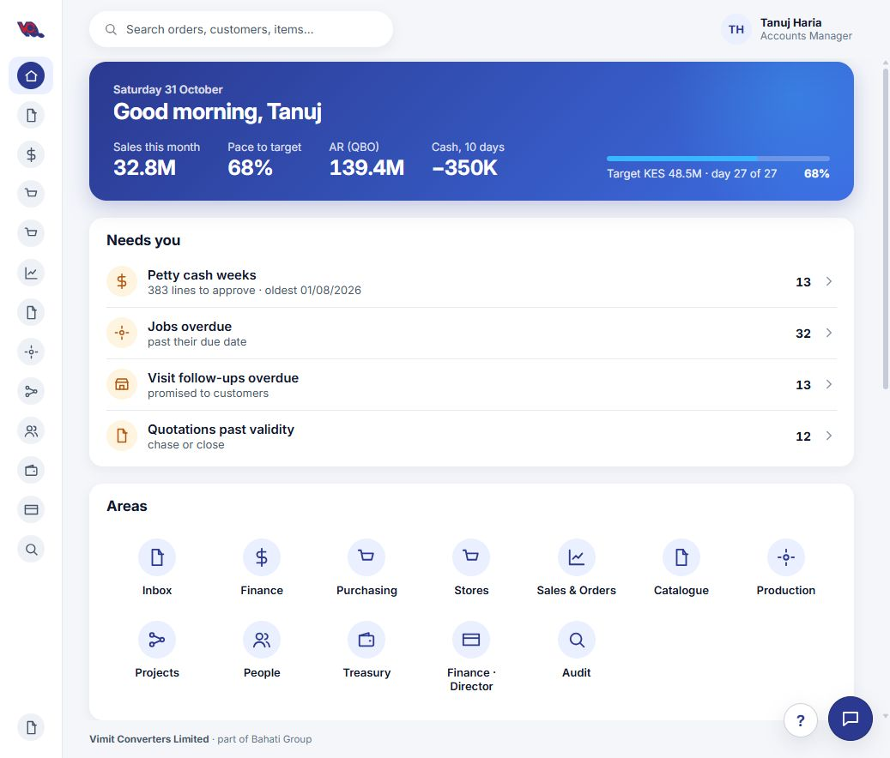
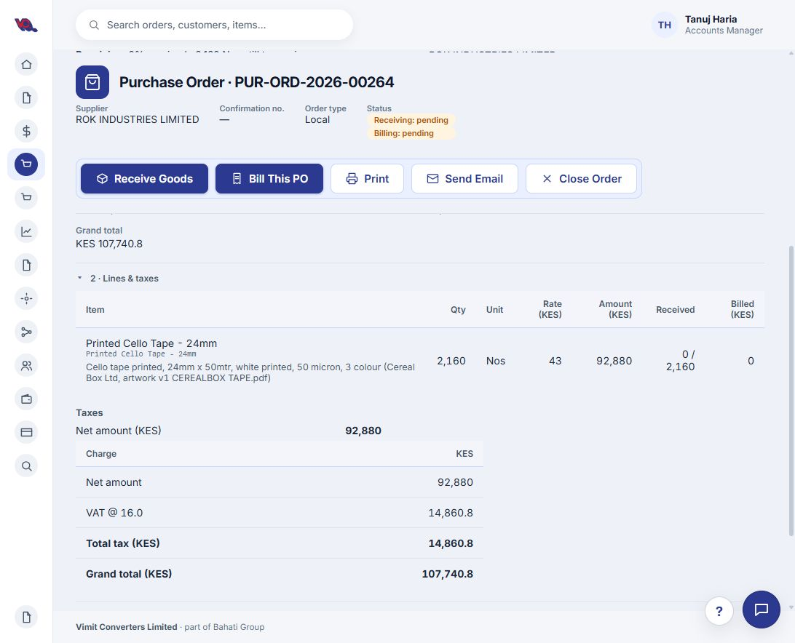
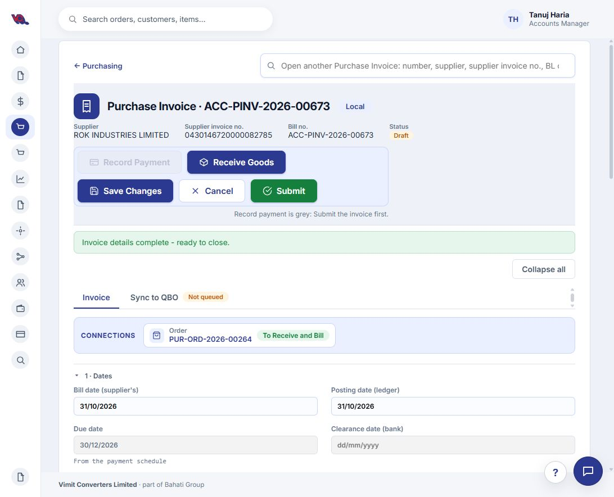

# Compass Change Requests

## CR-001: Make the Stores icon easier to recognise

- **Recorded:** 31 October 2026
- **Status:** Requested
- **Location:** Compass home page — Stores in the left navigation and Areas section.
- **Feedback:** The current Stores icon resembles a shopping basket and does not clearly represent stores or inventory and it is the same as the Purchasing Icon
- **Requested change:** Replace it with a warehouse or stacked-boxes icon that clearly represents Stores. Use the same icon in both navigation locations and retain the Stores label and tooltip.
- **Acceptance criteria:** Stores is visually distinct from Purchasing, and the replacement follows the existing icon size, stroke and colour styling.
- **Reference:** Browser comment 1 on https://vimitconverters.frappe.cloud/compass, targeting Stores in the left navigation.

## CR-002: Combine Purchasing searches across document types

- **Recorded:** 31 October 2026
- **Status:** Requested
- **Location:** Purchasing / Procurement — https://vimitconverters.frappe.cloud/compass/purchasing
- **Problem:** The page has three search bars: Global Search, BL/container search, and supplier/PO/confirmation/file-number search. Separate local searches make it unclear where to look and which document type a result represents.
- **Requested change:** Keep Global Search and combine the two Purchasing-specific search bars into one search covering Material Requests, Purchase Orders, Purchase Invoices and Receiving.
- **Search fields:** Support document references, supplier, PO, confirmation and file numbers, bill of lading (BL), container number, item name and item code. Find relevant documents through their linked records where applicable, so a BL, container or item search can also locate the associated invoice or receiving record.
- **Typo tolerance:** Allow misspellings and partial matches, particularly for item names. Prioritise exact document references and item-code matches over approximate matches.
- **Document-type controls:** Show clearly labelled document-type buttons beside the search field: **All**, **Material Requests**, **Purchase Orders**, **Purchase Invoices**, and **Receiving**. Users must be able to select **Purchase Invoices** to narrow the search and avoid confusing invoices with orders or receipts.
- **Result clarity:** Display the document type beside every result as a clearly labelled badge/button, along with its reference and enough context to distinguish it (for example supplier, date and status). Selecting a result opens that document.

### Acceptance criteria

1. Only one Purchasing-specific search field remains, in addition to Global Search.
2. The unified search finds all four supported document types without requiring the user to switch tabs first.
3. Users can search by BL, container number, item name or item code, as well as existing supplier and document-reference fields.
4. Partial queries and minor misspellings return relevant matches, with exact matches ranked first.
5. Selecting **Purchase Invoices** restricts results to invoices and visibly marks that document-type filter as active. **All** restores the cross-document search.
6. Every result clearly identifies its document type before the user opens it.
7. Empty results clearly state that nothing matched the query and selected document type.

## CR-003: Simplify the Procurement landing page

**CR-002 validation note:** During the walkthrough, entering **cereal box** in the existing local Purchase Orders search successfully found **PUR-ORD-2026-00264** through its printed-tape description. Preserve this existing capability in the unified search. Cross-document searching, item-code matching and typo tolerance still require separate validation.

- **Recorded:** 31 October 2026
- **Status:** Proposed — design recommendation for review
- **Location:** Purchasing / Procurement landing page.
- **Problem:** Creation buttons, two local search fields, four document summary cards, a second row of metrics, status filters and a large Purchase Order table compete for attention. The default order list makes the page feel focused on orders even when the user arrives to raise an invoice or receive goods.
- **Requested direction:** Make the landing page a clear starting point for finding documents, starting common tasks and handling exceptions. Open detailed document lists when selected.

### Proposed layout

1. **Header:** Procurement, with a short description.
2. **Find a document:** One unified Purchasing search with the document-type buttons from CR-002. Give search the most prominent position below the header. Keep Global Search in the application header.
3. **Start a task:** A compact row of clearly labelled actions: **Raise Material Request**, **Raise Purchase Order**, **Receive Goods**, **Create Purchase Invoice**. Confirm the existing receiving workflow and permissions before adding the Receive Goods shortcut.
4. **Needs attention:** One compact panel containing actionable exceptions, such as requests awaiting orders, late orders, receipts awaiting invoices and drafts awaiting submission. Use plain-language labels, show only relevant non-zero categories, and link each count to its filtered list. Confirm which counts matter for each user role; avoid treating every open record as an exception.
5. **Browse documents:** Four simple links or tiles: **Material Requests**, **Purchase Orders**, **Receiving**, **Purchase Invoices**. Selecting one opens its list with the detailed search, filters, totals and table for that document type.

### Reduce visual clutter

- Remove the full Purchase Order table and its filter strip from the initial landing view; retain them in the Purchase Orders list.
- Remove the second row of order metrics from the landing page and show those metrics within Purchase Orders.
- Avoid duplicate counts and repeated summaries of the same records.
- Use neutral styling for routine counts and reserve warning colours for actionable exceptions.
- Keep labels explicit, especially **Create Purchase Invoice**, so users can immediately identify the intended task.
- Preserve direct links to document lists and provide a clear route back to Procurement.

### Acceptance criteria

1. On a typical desktop viewport, search, common actions and the start of Needs attention are visible without scrolling.
2. A user can start creating an invoice directly from the landing page.
3. Each document list is reachable in one click, with its detailed filters and table available there.
4. The landing page has one Purchasing-specific search and no default full document table.
5. Attention counts have clear meanings, obey user permissions and open the matching filtered records.
6. The layout remains usable on smaller screens, with readable action labels and no horizontal page scrolling.

*This is a proposed redesign, not an implemented change. CR-002 defines the unified search behaviour.*

### Visual concept for review

*AI-generated design concept v1. Counts are illustrative; this is not the current application. Generated with the built-in image tool; prompt specification is saved in Procurement Design Prompt.md.*

## CR-004: Sort documents by Date Raised

- **Recorded:** 31 October 2026
- **Status:** Requested
- **Location:** Procurement document lists and search results, including vendor-filtered Purchase Orders.
- **Requested change:** Allow users to sort by **Date Raised**, choosing **Newest first** or **Oldest first**.
- **Date definition:** Date Raised means the record creation date/time, distinct from posting date, order date, due date and last modified date. Label it clearly and expose it in the list so the ordering is understandable.

### Acceptance criteria

1. A clearly labelled Date Raised sort control supports both directions and visibly indicates the active direction.
2. Sorting preserves the current vendor search and other filters; for example, searching ROK then sorting shows the matching records in date-raised order.
3. Sort the full matching result set before pagination or display limits, rather than sorting only the visible rows.
4. Apply the same behaviour to Material Requests, Purchase Orders, Receiving and Purchase Invoices.
5. Use a consistent secondary ordering for records with identical creation timestamps, so results remain stable.

## CR-005: Simplify the Purchase Order detail screen

- **Recorded:** 31 October 2026
- **Status:** Proposed — design recommendation for review
- **Location:** The Purchase Order screen before clicking **Bill This PO**, demonstrated on PUR-ORD-2026-00264. This request does not cover the subsequent billing form.
- **Problem:** The large action strip, repeated supplier/status information, empty Connections panel, approval notice and expanded detail sections compete with the items and next task. Print, Send Email and Close Order occupy similar space to receiving and billing actions.

### Proposed layout

1. **Compact header:** Show PO number, supplier, approval status and order date together. Keep a small Back to Purchasing link. Move Open another Purchase Order into a compact secondary control.
2. **Clear actions:** Keep **Receive Goods** and **Bill This PO** visible. Put **Print**, **Send Email**, **Open in Desk** and **Close Order** in a labelled **More actions** menu. Preserve any existing confirmation and permission checks.
3. **One progress strip:** Show Received and Billed quantities/percentages plus the grand total in a single compact row. Avoid repeating these as separate status blocks throughout the header and Details section.
4. **Items first:** Place the line-item table immediately below the summary. Show item name, readable description, ordered quantity, received quantity, rate and amount. Let long descriptions expand on demand without hiding useful identifying text such as Cereal Box Ltd.
5. **Compact totals:** Put net, VAT and grand total in a small summary beside or below the items, with detailed tax calculations expandable.
6. **Secondary details:** Group payment terms, required-by date, tax category and due-date schedule in a collapsed **Order details** section. Keep the required-by date visible near the header when overdue.
7. **Related documents:** Replace the full-width empty Connections panel with a compact **Related documents (0)** link or section. Show linked receipts and invoices clearly when present.
8. **Approval notice:** Use a small **Approved · Read-only** status near the heading, with an Open in Desk option, instead of a permanent full-width notice.

### Contextual receiving and billing guidance

- For this example, show **Received 0% · Billed 0%** clearly beside the actions.
- Provide a brief note when billing before receipt: **Goods have not been fully received. Review receipt status before billing.** Keep the existing detailed accounting explanation on the billing form.
- Keep billing accessible where the workflow permits it; do not automatically force receipt as a prerequisite or change accounting behaviour as part of the layout redesign.
- Choose action emphasis from the user's role and order state, while keeping both action labels easy to find.

### Acceptance criteria

1. PO number, supplier, receipt/billing progress, total and main actions are visible without scrolling on a typical desktop viewport.
2. The first item is visible in the initial viewport, with fewer repeated fields and banners above it.
3. Receiving and billing remain directly accessible; secondary actions are available through More actions.
4. Related receipts and invoices remain easy to find and open.
5. No permissions, approval rules, billing or stock behaviour change through this visual redesign.

### Proposed Purchase Order layout — concept v1

*Design concept for CR-005, generated with the built-in image tool. Proposed layout only; not a screenshot of the current application.*

**Design prompt:** Compact VCL Compass PO detail page with supplier and approval status in the header, Receive Goods and Bill This PO visible, secondary actions in More actions, one receipt/billing progress strip, items brought high up the page, compact totals, and collapsed Order details and Related documents sections. White and pale blue-grey surfaces with indigo accents; no oversized cards or repeated approval banners. Example PO PUR-ORD-2026-00264, ROK Industries, Printed Cello Tape 24mm, quantity 2,160 Nos, net KES 92,880 and total KES 107,740.80.

## CR-006: Complete the invoice draft in one workspace

- **Recorded:** 31 October 2026
- **Status:** Requested — inspected during walkthrough
- **Problem observed:** Bill This PO initially permits only supplier invoice number and date, with a read-only preview of the entire unbilled balance. The user then creates a draft, passes through a confirmation screen, opens the invoice, and clicks Edit Draft to adjust other details. This splits preparation across multiple screens and creates a saved draft before the user can review all editable values.
- **Verified example:** Created draft ACC-PINV-2026-00673 against PO PUR-ORD-2026-00264. Edit Draft exposes posting date, supplier reference, quantities, rates, line removal, tax calculation mode/amounts, payment terms and the receive-with-invoice choice. Attachments and cost-centre controls appear on the invoice page. These were inspected without changing or submitting the draft.

### Proposed workflow

1. **Bill This PO** opens a complete invoice preparation workspace populated from the PO.
2. Show supplier invoice number/date, posting date, supplier reference, editable line quantities/rates and line selection, tax review, payment terms with calculated due date, receipt treatment, cost allocation and supporting attachments in grouped sections. Only show import-specific fields when applicable.
3. Display ordered, received, previously billed and remaining quantities beside the proposed invoice quantity, so partial invoices can be prepared before saving.
4. Keep a live summary of net, tax and grand total, making before-tax versus tax-inclusive amounts explicit. The current creation footer shows KES 92,880 while the resulting draft totals KES 107,740.80 including VAT.
5. Use a clear **Save Draft** action. After saving, remain in the same workspace with the saved invoice reference and status; remove the separate success screen and extra Open invoice / Edit Draft steps.
6. Keep **Submit** a separate explicit action after review. Save all draft edits consistently through Save Draft/Save Changes; avoid controls that save immediately while other edits require a button.

### Validation and acceptance criteria

- Preserve PO links, permissions, receipt rules and server-side tax/payment calculations.
- Prevent duplicate creation on repeated clicks or retries; reopen the saved draft after successful creation.
- Validate allowed quantities and amounts, supplier invoice duplication and required fields with clear messages; do not silently change the PO.
- Due date updates from the supplier invoice date and selected payment terms, with a visible explanation.
- Make the stock receipt choice explicit and preserve the warning for goods not yet received. Do not automatically receive goods.
- **User-confirmed receiving requirement:** When Receive goods is unticked, the invoice must check against receiving records. Show matching receipts and quantities, and flag missing or insufficient receipt quantities for reconciliation before submission. Distinguish physical receipt confirmed by the user from receipt recorded in Compass. In this example the user confirmed physical receipt while the PO displayed 0% received. Define any exception/override policy explicitly with the business; do not silently tick Receive goods or create a duplicate stock receipt.
- Warn about unsaved changes when leaving; recover entered values after a validation error.
- Replace unconditional **Invoice details complete - ready to close** messaging with readiness based on actual checks. In this example the date remains today's default, goods are unreceived and there are no attachments; any required checks should be defined with the business rather than inferred from field population alone.

## CR-007: Review negative Paid so far display after submission

- **Recorded:** 31 October 2026
- **Status:** Observed — requires investigation
- **Example:** Newly submitted invoice ACC-PINV-2026-00673 shows Total KES 107,740.80, Outstanding KES 107,741 and Paid so far KES -0.20. No payment was recorded during the walkthrough.
- **Requested change:** Investigate the source of the difference, including rounding/adjustment treatment. Display actual payments separately from rounding or other adjustments; do not label a rounding difference as a negative payment. Align monetary precision and explain any legitimate difference between grand total and payable outstanding.
- **Acceptance:** A newly submitted invoice with no payments shows an accurate payment amount, and totals/outstanding reconcile with any adjustments explicitly labelled. Verify against underlying records before changing accounting values.

## DEF-001: Stage for QBO is slow and gives insufficient progress feedback

- **Recorded:** 31 October 2026
- **Status:** Observed — performance investigation required
- **Example:** ACC-PINV-2026-00673, Sync to QBO tab. Click Stage for QBO from Not queued. The button remains disabled as Staging… across subsequent observations, with no indication of the work underway. The user reported an excessive wait. Exact elapsed time was not measured.
- **Outcome:** Staging eventually succeeded as **QBPQ-2026-01380**, status Pending. This is a latency/usability defect, not a confirmed failed request. The invoice remains Not Synced; line 1 needs an item/account route before push. The review screen also displayed Asking KRA… and contradictory staging text (a queue ID exists but a checklist says not staged).

### Suggested improvements — investigate before implementation

1. Instrument time spent creating/updating the queue record, loading invoice data, vendor/item/account matching, external lookups and rendering. Establish the actual bottleneck; the screen alone does not establish the cause.
2. Keep the initial stage operation short: validate essentials, persist one queue entry and immediately return its reference. Perform expensive enrichment/checks in background jobs with durable status.
3. Reuse cached QuickBooks reference lists with a clear freshness policy. Avoid a full reference-list refresh for each invoice; batch database reads and index lookup keys where profiling supports it.
4. Run independent lookups concurrently and apply bounded timeouts to external services. Treat KRA/external validation as a visible separate check, with its own retry, rather than hiding it behind Staging.
5. Show explicit states such as Saving queue entry, Checking mappings and Awaiting external verification. Keep staged, ready to push and synced states distinct and consistent across the tab, banner and checklist.
6. Make staging idempotent. A retry or timeout must reopen/update the existing invoice queue entry rather than create duplicates. Let users leave and return while checks continue.

### Proposed acceptance targets

- Acknowledge the click immediately and show the persisted queue reference within **2 seconds at the 95th percentile under normal load**, subject to baseline measurement and engineering validation.
- Slow checks show their state and a recoverable timeout/retry message; the interface never spins indefinitely.
- Returning to the invoice restores accurate queue/check status, and repeated clicks/retries do not duplicate queue records.
- Pending checks cannot bypass existing push validation, and staging never implies successful QBO sync.

## CR-008: Make QuickBooks account versus item routing clear

- **Recorded:** 31 October 2026
- **Status:** Requested — prototype proposed
- **Problem:** Account and Item buttons share one narrow Posts to in QuickBooks cell, making the alternatives and selected destination hard to distinguish.
- **Proposal:** Use a **Post as: Account / Item** selector and separate **QuickBooks account** and **QuickBooks item** columns. Enable only the selected route's field; show the other as inactive. Each invoice line must have exactly one route. For small screens use a labelled line card instead of squeezing columns.
- **Acceptance:** The selected route and full destination name are immediately visible; switching routes clearly replaces the previous selection after confirmation where needed; validation prevents both or neither being used; save state is visible. Example: Account → Purchase Trading, with the Item column inactive.

## CR-009: Show the last three successful posting mappings

- **Recorded:** 31 October 2026
- **Status:** Requested
- **Purpose:** Help the person posting choose a consistent account/item without searching previous invoices manually.
- **Proposal:** For each line, show the last **three successful QBO postings** for the same supplier and ERP item code, newest first. Show posting date, invoice reference, route (Account or Item), destination name and tax code, with a link to the source and an explicit **Use this mapping** action.
- **Matching:** Clearly state the history scope. If no exact supplier + item history exists, show No previous postings; any broader item-only suggestions must be separately labelled. Use actual successful postings, excluding failed, draft or cancelled records.
- **Acceptance:** Suggestions never silently apply or push; the user reviews and applies one. Validate that the destination remains active and valid in the connected QBO company. Preserve audit/source references and permissions. Show up to three records, fewer when less history exists. Applying a suggestion updates the current queue line and shows its save state, without changing previous postings.
- **Prototype note:** Any example history shown in the visual prototype is illustrative, not retrieved posting history.

### Shared prototype for CR-008 and CR-009

*Generated UI concept, not the current application. History rows are examples only.*

**Prompt specification (built-in image generation):** VCL Compass Sync to QBO mapping table with distinct Post as, QuickBooks account and QuickBooks item columns; mutually exclusive Account/Item selector, Purchase Trading selected and Item inactive. Below the invoice line, show three illustrative successful posting suggestions for the same supplier and item, with explicit Use this mapping actions and a note that suggestions require review. Calm white/indigo enterprise styling and clear saved status.

## CR-010: Accept same-month late posting; review cross-month bill dates

- **Recorded:** 31 October 2026
- **Status:** Requested — user-defined business rule
- **Rule:** When the bill date is later than the supplier invoice date reported by KRA, accept the late date if both dates are in the **same calendar month and year**. If they fall in different months or years, ask the user to review the bill date before proceeding.
- **Example accepted:** KRA invoice date 27 October 2026 and bill date 31 October 2026. Under this rule the walkthrough's difference is acceptable.
- **Example requiring review:** KRA invoice date 31 October 2026 and bill date 1 November 2026.
- **UI:** Show both dates and explain Same-month late posting accepted, or highlight Cross-month date difference — review bill date. Include the result in the final push review as well as the KRA box. Keep supplier invoice date, bill date and ledger posting date clearly labelled; never silently overwrite dates.
- **Acceptance:** Compare month and year, not day difference or month number alone. A cross-month difference must pause the push for an explicit date review, with a route to correction. If a correction affects a submitted invoice, follow the supported correction/cancellation workflow. Missing/invalid KRA dates remain unverified. Earlier bill dates and any exception override policy require separately defined handling; this rule does not automatically approve them. Preserve existing period locks and permissions.

## CR-011: Allow Purchase Invoice cancellation in Compass

- **Recorded:** 31 October 2026
- **Status:** Requested
- **Problem:** The current flow advises cancellation in ERPNext Desk; Compass does not expose a cancellation action for the submitted invoice.
- **Proposal:** Add **Cancel invoice** under More actions for authorised users on submitted Purchase Invoices. Require a reason and show a review of the effects before the explicit final cancellation confirmation.
- **Review contents:** Invoice reference, supplier, total, status, linked PO, stock received through this invoice, payments/credits and QBO queue/sync state. Clearly distinguish cancelling a submitted invoice from deleting a draft.
- **Rules:** Use existing server-side cancellation permissions and validations. Identify linked records that block cancellation and explain how to resolve them. Reverse stock/accounting effects through the supported cancellation process, including dependent-stock checks, and refresh the PO's billed/received status from actual remaining transactions.
- **QBO handling:** Prevent a cancelled invoice from being pushed by a pending queue or in-flight job. If already synced, explain and coordinate the required QBO reversal/void/correction workflow; do not imply ERP cancellation also cancels the QuickBooks bill. Reconcile uncertain in-flight outcomes before retrying.
- **Acceptance:** Cancellation is auditable with actor, time and reason; repeat clicks/retries do not duplicate reversals; success updates invoice, PO and queue state consistently. Blocked or failed cancellations show a recoverable explanation. No silent deletion of submitted history. Any amendment/replacement invoice remains a separate explicit action.
