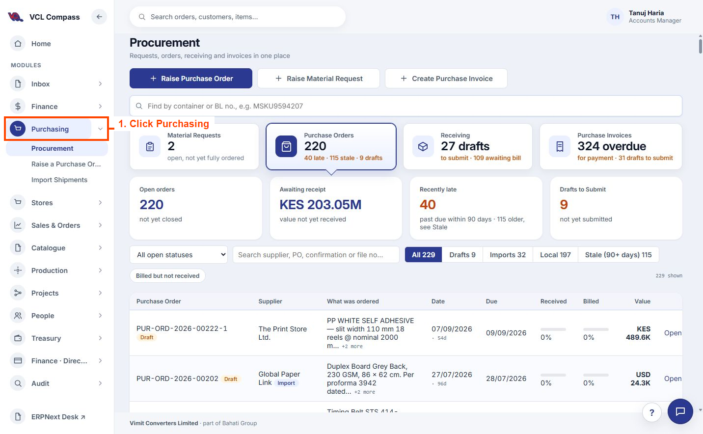
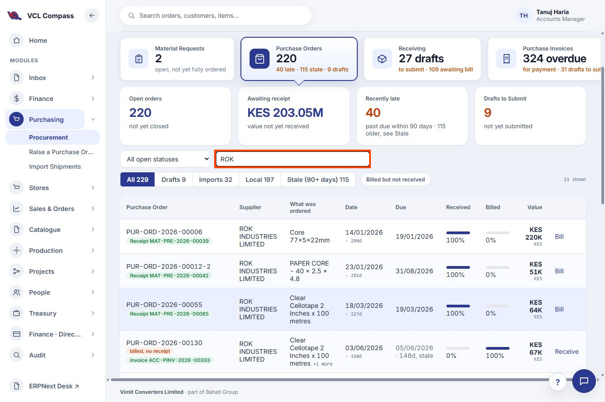
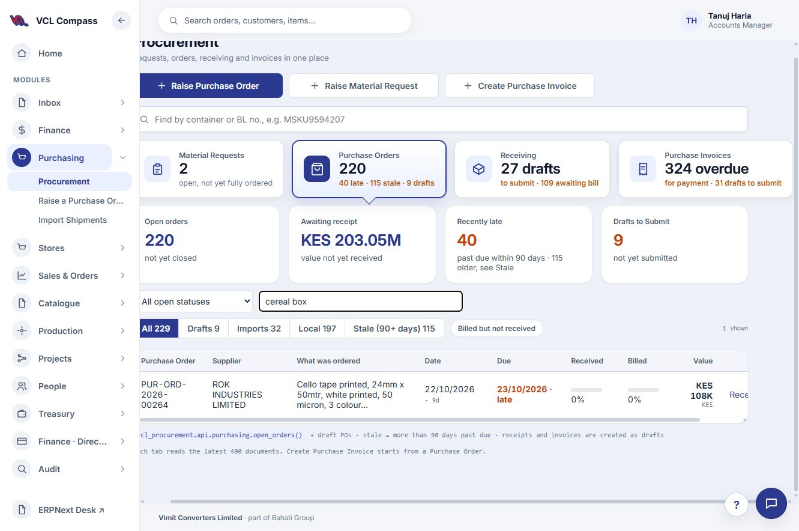
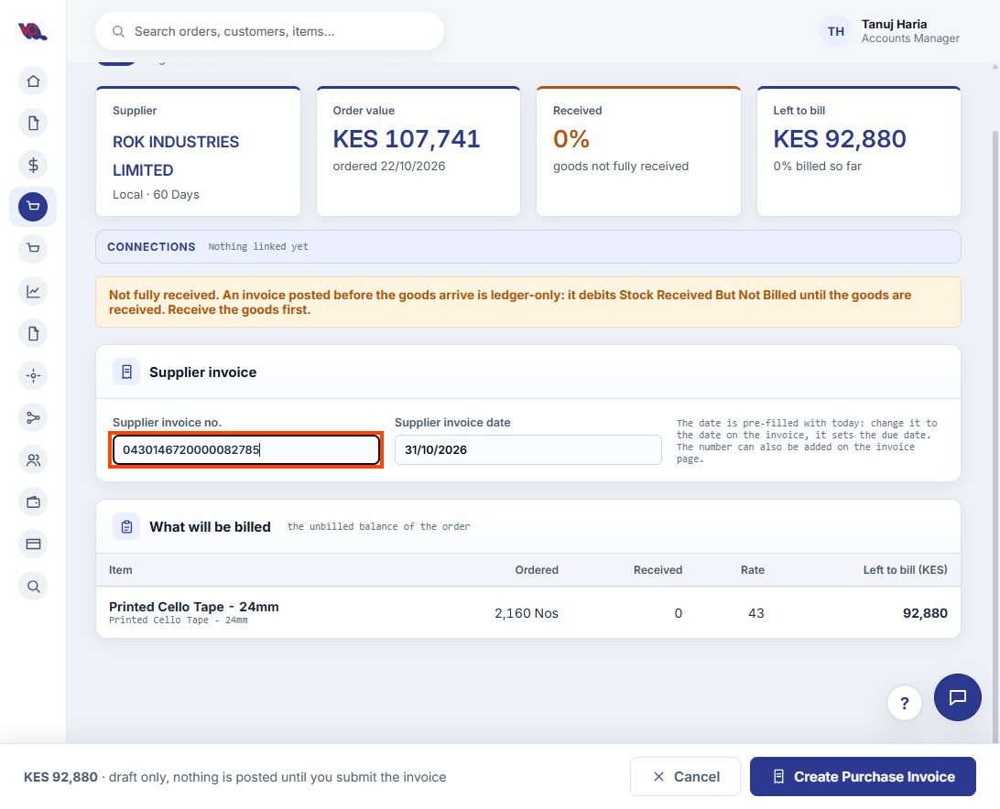
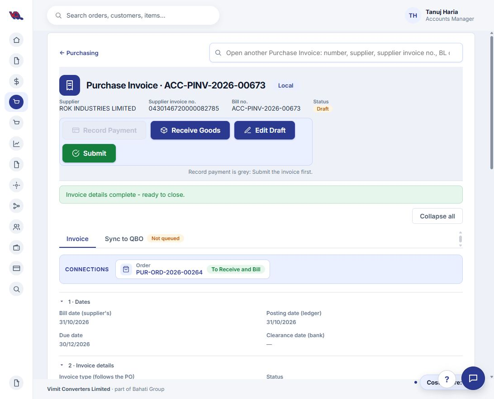

# Compass: How to Raise a Purchase Invoice

**Status:** Draft — being recorded during the walkthrough.  
**Updated:** 31 October 2026

This guide records the steps demonstrated in Compass, with screenshots at each key stage.

## 1. Open Purchasing

1. Open [Compass](https://vimitconverters.frappe.cloud/compass).
2. On the home page, select **Purchasing** under **Areas**, or use **Purchasing** in the left menu.

*Figure 1. Purchasing appears in the Areas section on the Compass home page.*

After selecting **Purchasing**, the **Procurement** screen opens. The screenshot below highlights the Purchasing navigation entry. This screen includes **Create Purchase Invoice** at the top.

*Figure 2. Purchasing opened — the orange outline identifies the navigation target.*

## 2. Search for the vendor

In the **Purchase Orders** view, enter the vendor name in the supplier/PO search field above the list. For this example, type **ROK** to find **ROK INDUSTRIES LIMITED**.

The demonstrated search shows **11 matching purchase orders** under the current filters. Review the order references, items, received and billed percentages to identify the relevant order.

*Figure 3. Enter ROK in the local supplier/PO search field, outlined in orange.*

## 3. Find the order by vendor or item description

Use the local search field to find the purchase order by either **vendor name** or **item description**:

- **By vendor:** Enter **ROK** or **ROK INDUSTRIES LIMITED**, then identify the relevant order from the matching results.
- **By item description:** Enter a recognisable phrase such as **cereal box** to narrow the results to the printed tape order.

In this walkthrough, searching **cereal box** returned one match: **PUR-ORD-2026-00264**, for **ROK INDUSTRIES LIMITED**. Both vendor and item-description searching were demonstrated in the current application.

Open the purchase order reference and verify its line details:

- **Item:** Printed Cello Tape - 24mm
- **Description:** Cello tape printed, 24mm x 50mtr, white printed, 50 micron, 3 colour (Cereal Box Ltd, artwork v1 CEREALBOX TAPE.pdf)
- **Quantity:** 2,160 Nos at KES 43 each
- **Grand total:** KES 107,740.80
- **Order date:** 22 October 2026

The order currently shows receiving and billing pending. Further invoice steps will be recorded during the walkthrough.

## 4. Open the billing form

On the purchase order, select **Bill This PO**. Compass opens **Bill this Purchase Order** against the selected PO and supplier.

The form includes the supplier invoice number and invoice date. The date defaults to today; use the date printed on the supplier's invoice. Review the items and unbilled balance. In this example, Compass shows 0% received and a notice explaining billing before receipt.

At this stage, the billing form is open; no Purchase Invoice has been created yet.

## 5. Enter the supplier invoice number

Enter the number exactly as printed on the supplier's invoice in **Supplier invoice no.**, including any leading zeros.

For this example, enter **0430146720000082785**.

The number has been entered in the form. The invoice date still shows 31 October 2026 and has not yet been confirmed against the supplier document. The Create Purchase Invoice button has not been clicked.

## 6. Create and open the draft invoice

Select **Create Purchase Invoice**. Compass saves a draft and shows its reference. For this example, it created **ACC-PINV-2026-00673** for **ROK INDUSTRIES LIMITED**, linked to **PUR-ORD-2026-00264**.

Select **Open invoice**. Use **Edit Draft** to review or adjust the posting date, supplier reference, quantities, rates, taxes and payment terms. Review the supplier invoice date against the supplier document. The demonstrated draft currently has bill and posting dates of **31 October 2026**, due date **30 December 2026**, and total **KES 107,740.80**.

**Walkthrough status:** The draft has been created and opened. Edit Draft was inspected and cancelled without changes. The invoice has not been submitted; receipt treatment remains ledger-only with Receive goods unticked.

## 7. Verify goods receipt

If **Receive goods** is unticked, check the invoice against the receiving records and confirm that the goods have been received. Reconcile the relevant items and quantities with the receipt before proceeding.

For this example, the user has confirmed that the goods were physically received. Compass previously showed **0% received** against PO PUR-ORD-2026-00264; the receiving record still needs to be reconciled with that confirmation.

If a separate receipt already records these goods, keep **Receive goods** unticked to avoid receiving them twice. The option to receive stock with the invoice applies only when no separate receipt has been or will be made for those goods.

For this example, the user chose **receive through this invoice**. Under **Invoice details**, tick **Receive the goods into stock with this invoice**. Outside Edit Draft mode, this choice saves immediately. Wait for **Saved** and confirm that the box remains ticked.

**Current status:** Receive goods is ticked and saved on draft **ACC-PINV-2026-00673**. Compass states that the goods will be received into stock when the invoice is submitted. The invoice remains a draft; stock receipt has not yet been posted through it.

## 8. Submit the invoice

Select **Submit**, review the confirmation showing supplier, invoice number, ledger date, total and stock receipt warehouse, then select **Yes, submit**.

For this example, Compass confirmed **Submitted. ACC-PINV-2026-00673 is now posted.** The invoice status changed to **Unpaid**, Receive goods shows **Yes**, the item uses **Stores - VCL** and **1410 - Stock In Hand - VCL**, and the linked PO status changed to **Completed**. Do not also receive these goods against the PO.

**Final walkthrough result:** Invoice ACC-PINV-2026-00673 was submitted with stock receipt enabled. No payment was recorded. The screen shows total KES 107,740.80, outstanding KES 107,741 and Paid so far KES -0.20; this display discrepancy needs review and should not be interpreted as a payment.

## 9. Open Sync to QBO

After submission, select the **Sync to QBO** tab beside Invoice.

For this example, the tab shows **Not Synced**, **Push queue: Not queued**, no QBO bill ID or last-sync time, and QBO transaction date **31 October 2026**. A **Stage for QBO** button is available. Opening this tab has not synced or staged the invoice; the next action will be recorded during the walkthrough.

## 10. Stage for QBO

Select **Stage for QBO** and wait for the queue reference. In this walkthrough the action was slow, but eventually showed **Staged as QBPQ-2026-01380. Review it, then push.**

Staging prepares the queue record; it does not mean the invoice has synced. This example remains **Not Synced**, with queue status **Pending**. The review identifies line 1 as **Not routed**, requiring an item/account selection before push. No push has been performed. A staging-delay defect has been recorded separately.

## 11. Select the QuickBooks vendor first

First, select the correct **QuickBooks vendor** in the Vendor section. If a vendor is already matched, verify that it is the correct supplier; use **Change vendor** if needed.

If the vendor does not appear:

1. Create the vendor in **QuickBooks**.
2. Return to **Sync to QBO** in Compass.
3. Click **Update Vendors** under QuickBooks lists and wait for the refresh to finish.
4. Select the newly created vendor in the Vendor section.

For this example, Compass currently shows **ROK INDUSTRIES LIMITED** as the matched QuickBooks vendor. Verify this match before proceeding to item/account mapping.

## 12. Select an account or item for each invoice line

Under **Items**, choose either **Account** or **Item** to determine how each line will post in QuickBooks, then select the appropriate destination.

For this example:

1. Select **Account** for Printed Cello Tape - 24mm.
2. Search for **Purchase Trading**.
3. Select **Purchase Trading** (not Purchase Trading:Printing Works).
4. Wait for **Saved automatically** and verify the line shows **Account: Purchase Trading**.

The mapping is saved and **Review and push** is available. No push has been performed.

**Date discrepancy to resolve before push:** The KRA review shows invoice date **27 October 2026**, while the bill date is **31 October 2026**. Confirm the correct date against the supplier invoice; matching amounts do not resolve this date difference.

## 13. Check VAT

Review the **VAT** section. Confirm that the tax code and tax calculation basis match the supplier invoice and that the QuickBooks VAT amount agrees with ERPNext.

For this example, the displayed tax code is **Standard (16%)**, the calculation basis is **Exclusive**, and VAT is **KES 14,860.80** in both systems.

## 14. Check iTax / KRA last, then review the push

The **iTax / KRA** box is the final check. Verify the supplier, buyer, invoice number (CUIN), invoice date, taxable amount, VAT and total against the supplier invoice. Resolve discrepancies even if the box is green or marked Matches.

Once all checks are green, the details are correct and all changes are saved, click **Review and push** to open the final review before anything is sent to QuickBooks.

**Current example:** VAT agrees, but the KRA date of **27 October 2026** differs from the bill date of **31 October 2026**. This needs confirmation/correction before proceeding. Review and push has not been clicked.

## 15. Review again and confirm the push

Clicking **Review and push** opens the **Push to QuickBooks?** confirmation. Review the vendor, bill number and date, item/account mapping, quantities, amounts, VAT and memo again.

When the details are correct and any discrepancies have been resolved, click **Yes, push** to send the bill to QuickBooks. Select **Not yet** to return and make corrections.

**Walkthrough status:** The final confirmation is open. Yes, push has not been clicked. The previously noted invoice-date discrepancy remains unresolved.

### Date review rule — confirmed during the walkthrough

Accept late posting when the bill date and KRA supplier invoice date are in the **same calendar month and year**. If they fall in different months or years, review the bill date before proceeding.

For this example, **27 October 2026** and **31 October 2026** are in the same month and year, so the date difference is **accepted under the user's business rule**. This resolves the date-review concern noted above; no dates were changed. The final push confirmation remains open and no push has been performed.

The remaining invoice creation steps will be added as they are demonstrated.
