# Compass Purchase Invoices — Suggested Process Changes

**Prepared:** 31 October 2026  
**Basis:** Live walkthrough of ROK Industries PO PUR-ORD-2026-00264, invoice ACC-PINV-2026-00673 and QBO queue QBPQ-2026-01380.  
**Status:** Recommendations for review; no software changes implemented.

## Recommendation

Make invoice preparation one continuous workspace, with clear checkpoints for goods receipt, invoice posting and QuickBooks sync. Reduce repeated navigation and information entry while keeping submission and external posting explicit.

The largest improvement is to replace the current Create → success page → Open invoice → Edit Draft sequence with a complete editable draft opened directly from the PO. Visual cleanup helps, but removing this interrupted preparation flow will do more for the person posting.

## Proposed process

| Step | What the user does | What Compass should do |
| --- | --- | --- |
| 1. Find | Search by vendor, PO, item, BL or container | Return clearly labelled document types, with Date Raised sorting and relevant filters. |
| 2. Prepare | Open Bill This PO and enter invoice details | Open a complete draft workspace populated from the PO, including editable quantities/rates, dates, taxes, terms and attachments. |
| 3. Confirm receipt | Choose existing receipt or receipt through invoice | Reconcile recorded receipt quantities, or show the explicit stock effect of receiving through the invoice. |
| 4. Save and review | Save Draft and check invoice totals | Keep the user in the same workspace, preserve progress and identify unresolved checks. |
| 5. Submit | Review and confirm posting | Post the invoice and selected stock receipt once, then show a compact confirmation and next action. |
| 6. Prepare QBO | Verify vendor, account/item, VAT and KRA | Prepare a queue entry promptly; show background-check progress and suggested mappings from successful history. |
| 7. Push | Review the exact bill again and confirm | Send only after explicit confirmation; show success, QBO bill ID, or an actionable failure. |

A persistent progress indicator could show **Draft → Submitted → QBO staged → QBO synced**, with the current state and next action. “Submitted” must never imply “Synced”.

## Priority 1 — Correctness and clear decisions

### Make receiving an explicit choice

Replace the ambiguous checkbox with two labelled options: **Use a recorded goods receipt** and **Receive goods through this invoice**. Show the matched receipts and remaining quantities beside the first option. Show the warehouse and proposed receipt quantities beside the second. Physical receipt confirmation and a saved receiving record are different facts.

If using recorded receipts, reconcile items and quantities before submission and flag missing coverage. If receiving through the invoice, explain that stock posts when the invoice is submitted and prevent duplicate receipt of the same quantities. Keep partial-receipt scenarios visible. Any permitted exception needs a defined business rule.

**Why:** In the walkthrough the goods were physically received but the PO showed 0% received. The user explicitly chose receipt through the invoice. This decision should be clear during preparation rather than discovered later. **Reference: CR-006.**

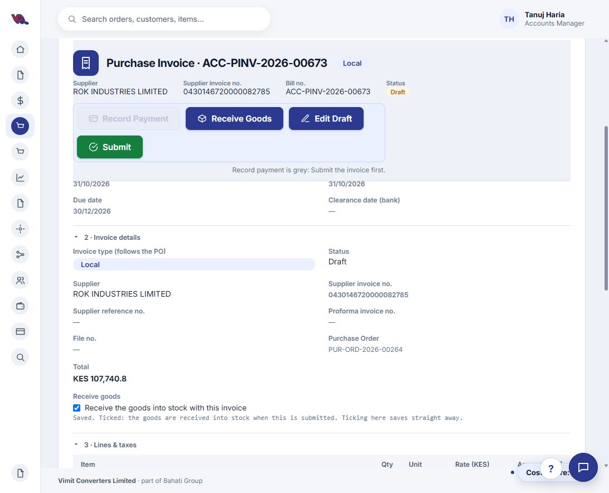

*Current screen: the Receive goods choice is inside Invoice details and saves immediately. The proposed preparation workspace would bring this decision forward.*

### Apply the agreed date rule visibly

Retain the supplier invoice date, bill date and ledger posting date as distinct labelled values. Apply the user's rule: accept a later bill date in the same calendar month and year; require bill-date review when the dates cross months or years. Do not silently change dates or bypass locked periods.

For this invoice, KRA's 27 October and the bill's 31 October are acceptable under the agreed rule. Show **Same-month late posting accepted** rather than a generic green Matches badge that hides the comparison. This is the user's operational rule, not an independently assessed tax policy. **Reference: CR-010.**

### Make readiness and amounts trustworthy

Replace “Invoice details complete — ready to close” with specific checks and separate **Ready to submit** from **Ready to push**. Show unverified, checking, passed and needs-review states. Include the KRA result and accepted date exceptions in the final push review.

Investigate the negative Paid so far value before changing accounting data. The new invoice showed total KES 107,740.80, outstanding KES 107,741 and Paid so far KES -0.20 without any payment. Show actual payments and any rounding adjustments separately. Also fix the contradictory “not staged” checklist when a queue reference already exists. **References: CR-007, DEF-001; readiness extension to CR-006.**

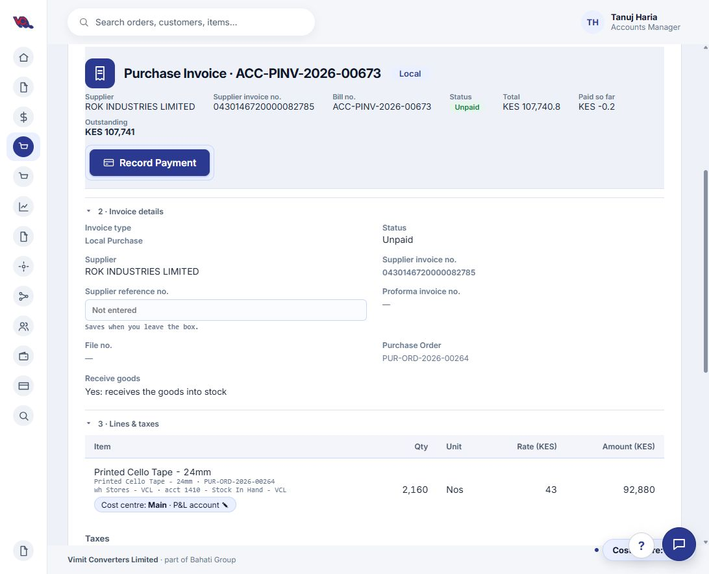

*Observed defect: Paid so far shows KES -0.20 even though no payment was recorded in the walkthrough.*

## Priority 2 — Remove repeated work

### Complete the draft before saving it

Bring all routine preparation fields into the first Bill This PO workspace: supplier invoice number/date, posting date, supplier reference, line selection, quantities, rates, tax review, payment terms, calculated due date, receipt method, allocation and attachments. Put less frequent details in expandable sections.

Use **Save Draft** consistently and keep submission separate. After saving, stay on the same invoice; remove the full-page success screen. Show net, tax and gross totals throughout so a KES 92,880 net preview is not mistaken for the KES 107,740.80 invoice total. **Reference: CR-006.**

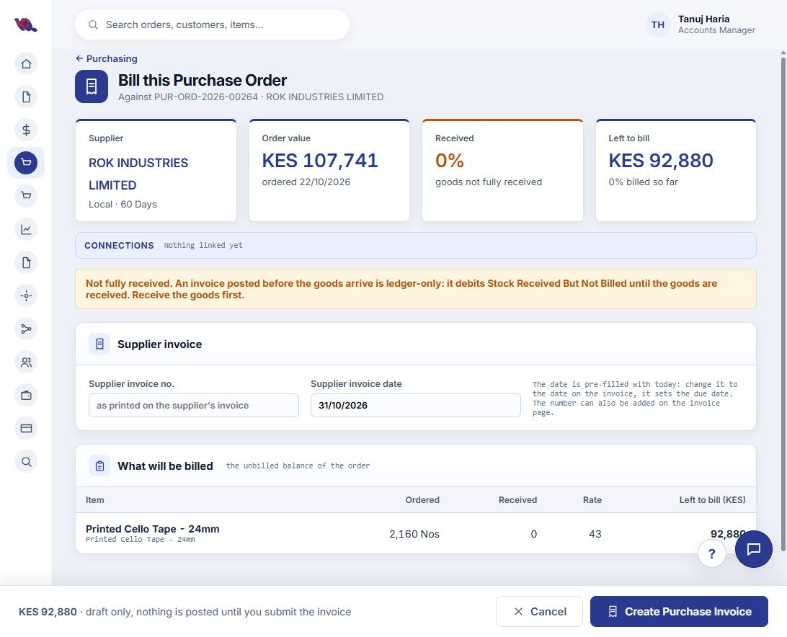

*Current screen: only the supplier invoice number and date are editable before creating the draft; line details are a preview.*

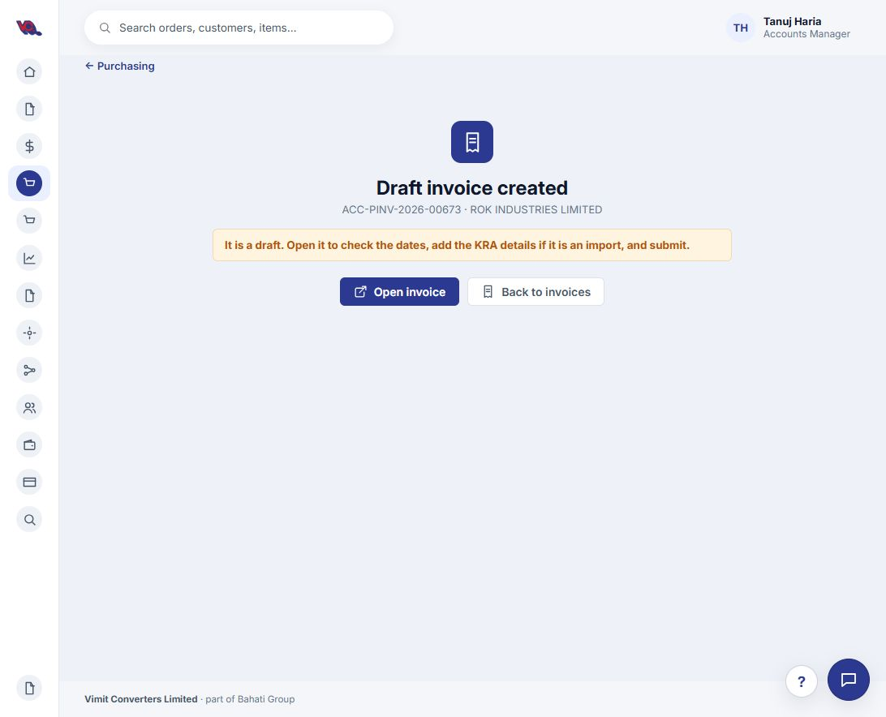

*Current extra step: the user must open the saved invoice and then choose Edit Draft. Replace this page with an inline saved confirmation in the complete workspace.*

### Simplify staging and expose background work

Measure where staging time is spent before prescribing a backend fix. Save one queue record promptly, return its reference and perform slow matching/enrichment in the background. Reuse reference lists with controlled refresh, batch lookups where appropriate and time out external checks separately.

Show what is happening, let the user return later and make retries reuse the same queue record. A suggested performance target is a queue reference within two seconds at the 95th percentile under normal load, to be validated after measuring the baseline. The walkthrough established a perceived delay, not a measured duration or root cause. **Reference: DEF-001.**

I would also investigate why this submitted invoice was not queued automatically even though the page said it normally is. If automatic staging is intended, repair that path; otherwise make manual staging an explicit next action. Automatic staging should never automatically push to QBO.

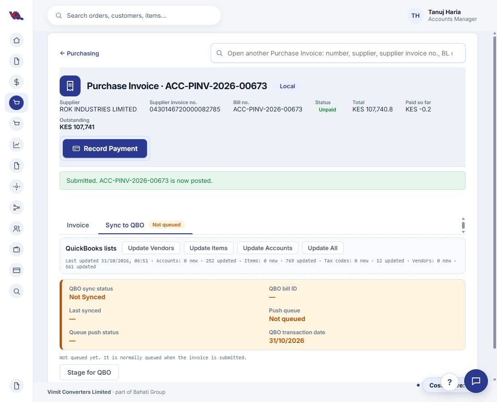

*Current screen: the submitted invoice is Not queued and offers Stage for QBO.*

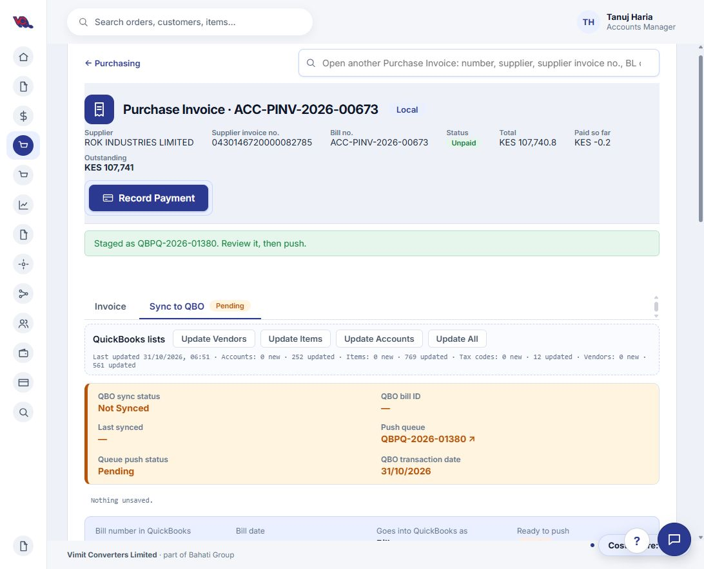

*Observed outcome: a queue reference was eventually created with Pending status. These screenshots show before and after; the elapsed delay was not measured.*

### Make account/item mapping obvious and assisted

Use a **Post as: Account / Item** selector with separate destination columns. Enable exactly one destination per line. Display full names and save state clearly; use line cards on narrow screens.

Show the last three successful postings for the same supplier and item, with date, invoice link, account/item and tax code. Offer **Use this mapping**, but require the user to apply it. Label broader matches and never fabricate history or reuse inactive destinations. For this example, the chosen route is **Account → Purchase Trading**. **References: CR-008, CR-009.**

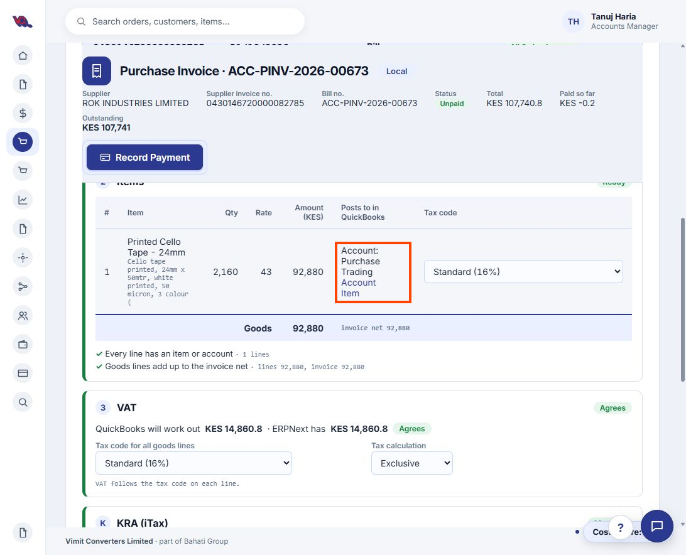

*Current screen: Account and Item share a narrow cell. The orange outline marks the routing controls; the proposal below separates the destinations and adds history.*

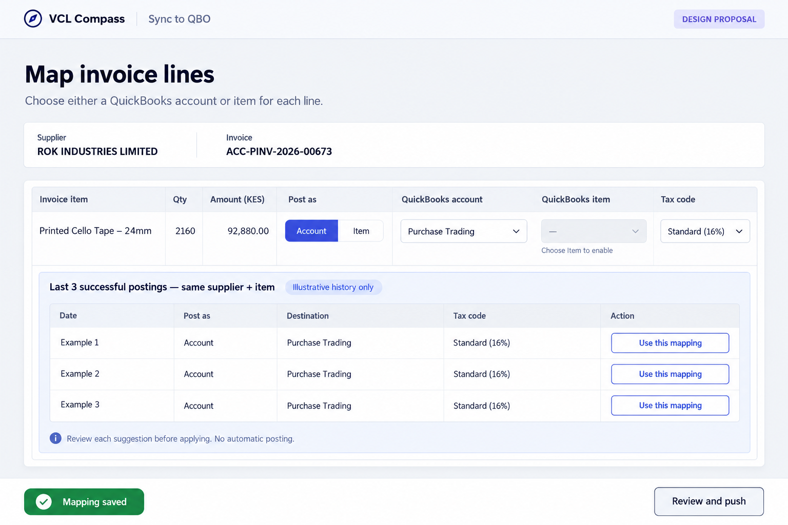

*Design proposal only. History rows are illustrative; these are not retrieved previous postings.*

## Priority 3 — Make navigation calmer

### Simplify Procurement

Keep Global Search and one unified Purchasing search, followed by common tasks, a compact Needs attention panel and links to document lists. Move detailed tables and metrics into their respective lists. Add document-type buttons and Date Raised sorting. Preserve the existing vendor and item-description searches, both of which worked during the walkthrough. Validate item-code matching and typo tolerance separately. **References: CR-002, CR-003, CR-004.**

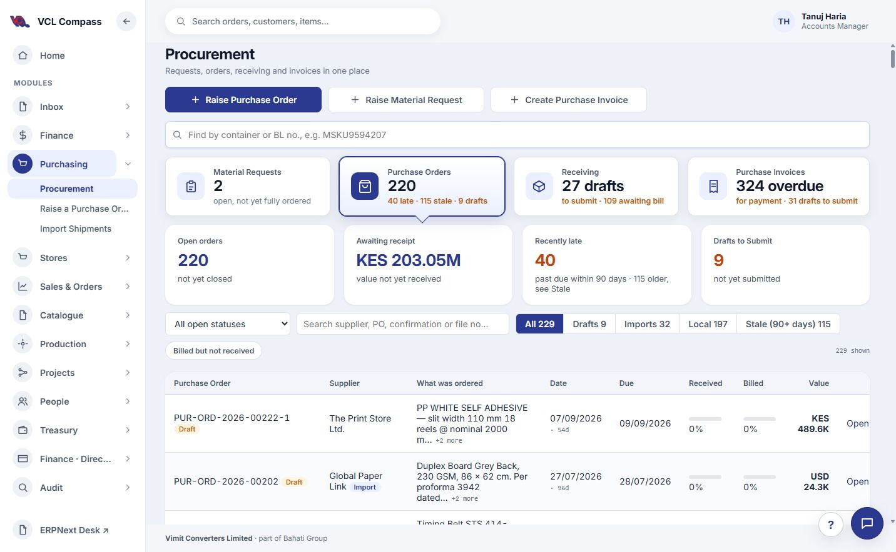

*Current screen: creation actions, local search, summary cards, order metrics, filters and a table compete for space. The proposal below reduces this initial view.*

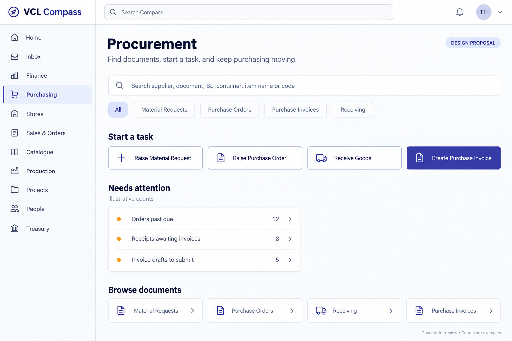

*Design proposal; counts are examples.*

### Simplify the PO page

Keep PO number, supplier, total, receipt/billing progress and the two main actions in a compact header. Bring the items higher up. Move Print, Email and Close Order into More actions, collapse secondary details and reduce repeated status banners. Replace the Stores shopping-basket icon with a warehouse icon. **References: CR-001, CR-005.**

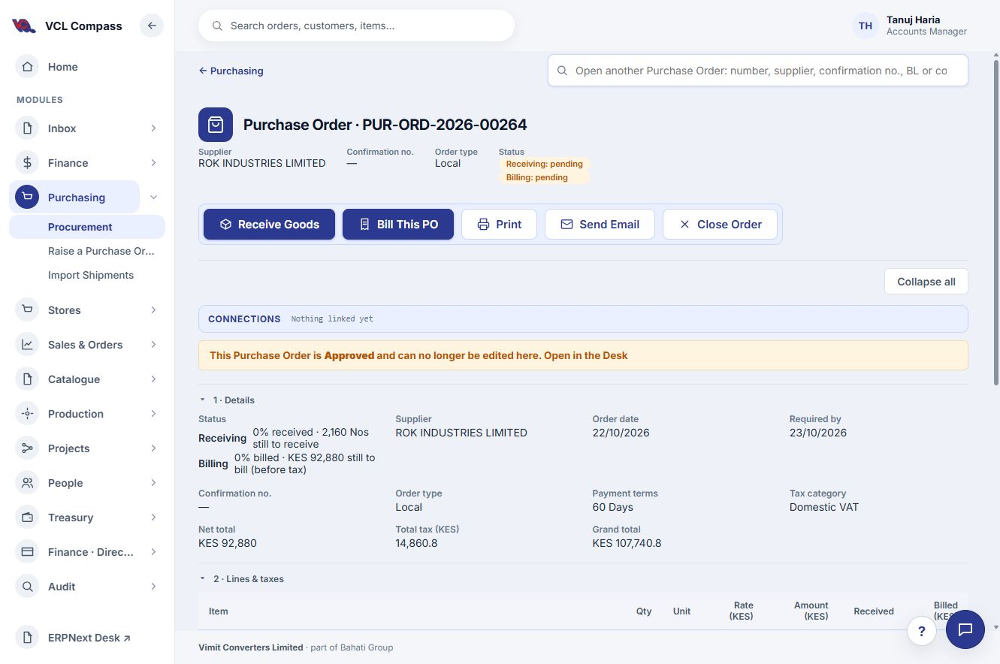

*Current screen: actions, Connections, the approval notice and Details sit above the line items. The proposal below brings the items higher up.*

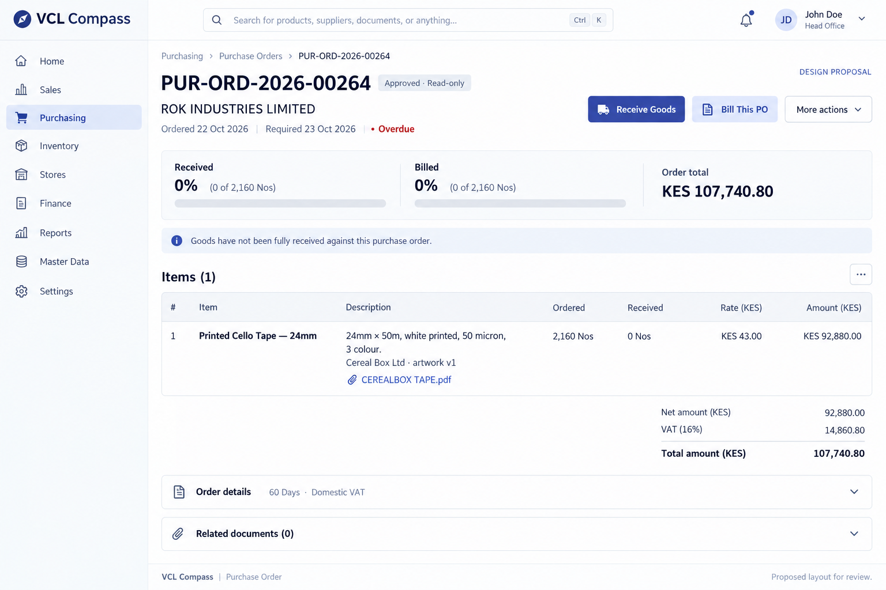

*Layout concept. Surrounding navigation and example identity are illustrative; the change request defines the intended scope.*

## Provide a correction route inside Compass

Add an authorised **Cancel invoice** action with reason, impact review and explicit confirmation. Respect stock dependencies, payments and existing ERP validations. A pending or in-flight QBO push must be reconciled before cancellation; a synced bill needs a clearly coordinated QBO correction process. ERP cancellation must not be presented as automatic QBO cancellation.

Explain blocked cancellations and preserve audit history. A replacement/amendment should be a separate action. This change needs more validation than the visual improvements because it affects accounting and stock. **Reference: CR-011.**

## Keep a clear final push review

Retain the final review and explicit **Yes, push** action. Include the resolved date-check result, complete vendor/account names, tax basis and total in this review. A green summary should represent the actual checks, and the user should be able to return to corrections without losing the queue mapping.

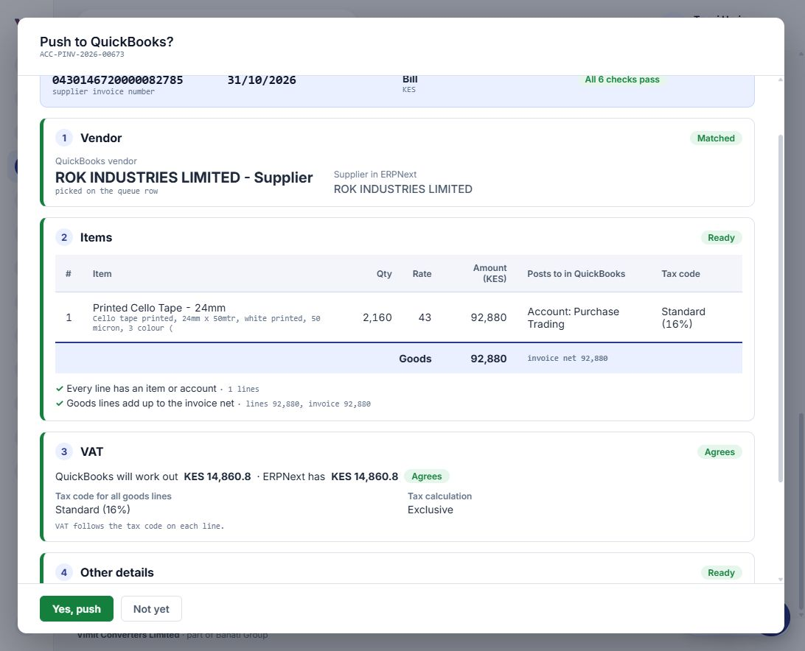

*Current screen: a separate final confirmation is already present. Preserve this checkpoint while making the status and date checks consistent.*

## Suggested delivery order

| Release | Scope | Evidence of success |
| --- | --- | --- |
| 1. Trust and feedback | Receipt choice/checks, date rule, accurate payment/readiness labels, staging progress and consistent status | Users understand stock effects; dates follow the agreed rule; totals reconcile; no contradictory queue states. |
| 2. Faster preparation | One draft workspace, direct continuation after save, quicker staging, clear mapping and recent history | Fewer page transitions and corrections; faster measured preparation/staging; no duplicate invoices or queue entries. |
| 3. Navigation and recovery | Unified search, sorting, landing/PO redesign, tested cancellation flow | Users find the correct document faster and can resolve supported invoice mistakes within Compass. |

Track median and 95th-percentile preparation/staging times, number of navigation steps, mapping changes, failed pushes and duplicate attempts. Establish baselines before assigning improvement percentages. Validate with local and import invoices, partial receipts, partial billing, missing vendors, cross-month dates and cancelled/synced records.

## Walkthrough position

Invoice **ACC-PINV-2026-00673** is submitted with receipt through the invoice. Queue **QBPQ-2026-01380** is staged, with Purchase Trading selected and VAT agreeing. The final **Push to QuickBooks?** review is open; **Yes, push has not been clicked**. No payment was recorded.

Related documents: [Detailed change requests](Change%20Requests.md) · [Current-process user guide](Purchase%20Invoice%20User%20Guide.md).
